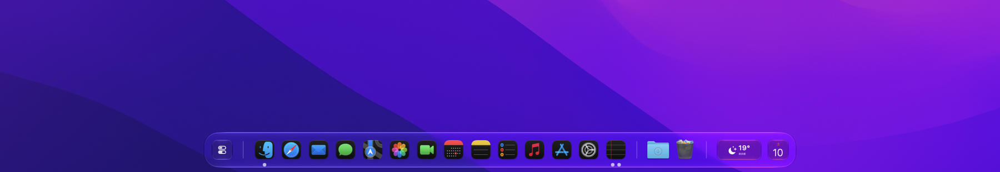
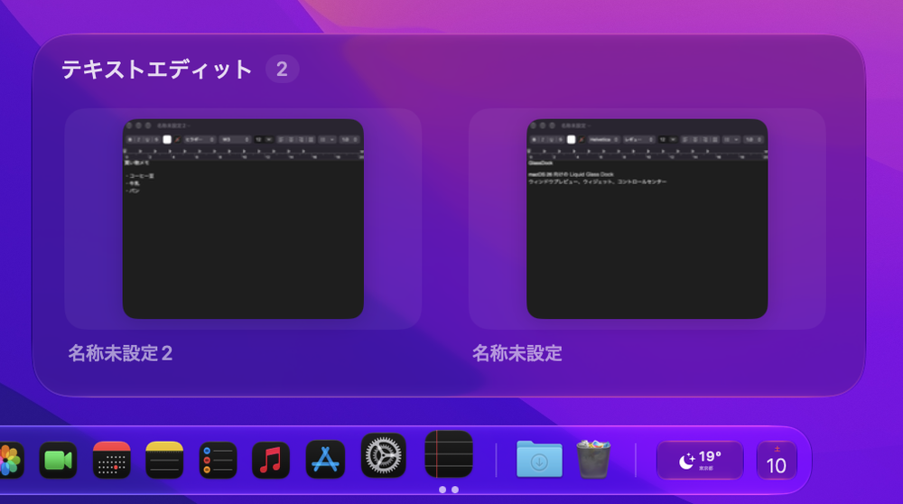
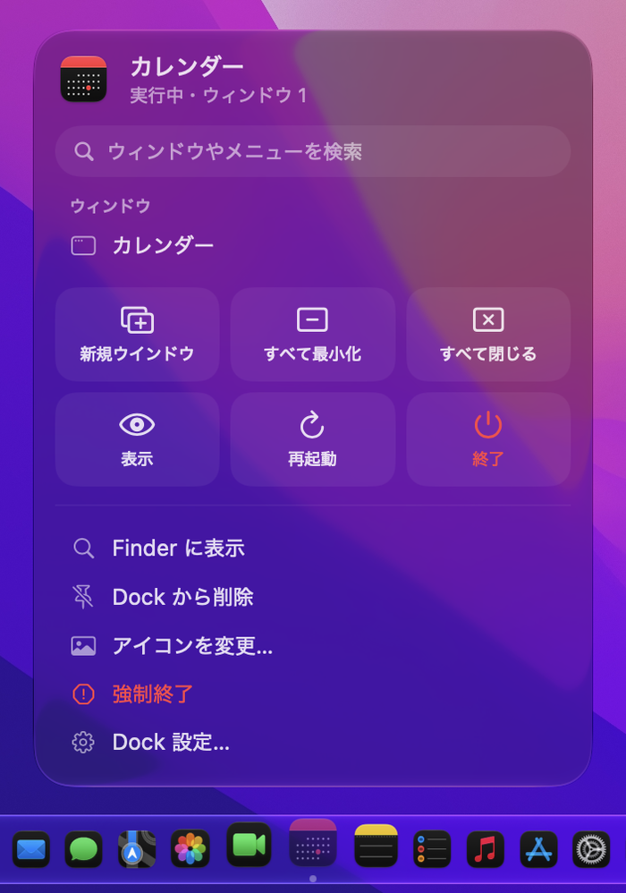
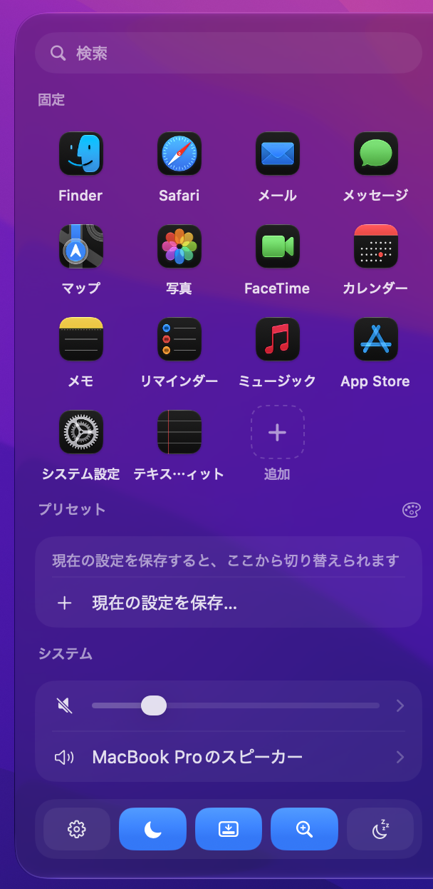

# GlassDock

macOS 26 以降向けの、Liquid Glass で描かれたカスタム Dock です。アイコンにホバーするとウィンドウのライブプレビューを表示し、天気や予定などのウィジェットを Dock に並べられます。

[English](#english)



## 主な機能

- **macOS の Dock と同じ Liquid Glass**：システムの Dock と同じ種類のガラスで描画します。素材・色・角丸・枠線・影も調整できます
- **ウィンドウプレビュー**：ホバーでウィンドウのサムネイルを表示します。クリックで前面に出し、最小化や閉じる操作もできます
- **右クリックメニュー**：ウィンドウやメニュー項目の検索、全ウィンドウの最小化・閉じる、再起動などができます。アプリ独自の Dock メニュー（ブラウザの「新規シークレットウインドウ」など）も取り込みます
- **ウィジェット 25 種類**：時計、世界時計、カレンダー、次の予定、リマインダー、天気、再生中の曲、音量、CPU・GPU・メモリ、バッテリー、ストレージ、ネットワーク、周辺機器の残量、ヘルスチェック、ポモドーロ、クイックメモ、クリップボード履歴、カラーピッカーなど
- **システム概要**：CPU・GPU・メモリ・ネットワーク・ストレージ・バッテリーをまとめて表示し、項目を選ぶと使用量の多いアプリ順に並べます。SoC とバッテリーの温度も表示します
- **コントロールセンター**：アプリ検索、固定アプリ、音量と出力先、起動中アプリの一覧、ダークモードなどの切り替えをまとめています
- **プリセット**：Dock の配置・外観・固定アプリ・ウィジェットなど、すべての設定を名前を付けて保存し、ワンタップで切り替えられます
- **ウィンドウスイッチャー**：Option+Tab で開いているウィンドウをサムネイル付きで一覧し、Tab で選んで切り替えます
- **ウィンドウの自動調整**：Dock を常に表示しているときは、タイトルバーのダブルクリックや地球儀キー＋Control＋F などで、最初から Dock を避けた大きさに広げます
- **複数ディスプレイ**：ディスプレイごとに Dock の表示・大きさ・外観を設定でき、設定の「ディスプレイ」で管理できます
- **フォルダとゴミ箱**：フォルダはホバーで最近のファイルを表示し、ゴミ箱はその場で空にできます。ダウンロードが届くと印を付けて知らせます
- **音楽アプリ**：Spotify・ミュージックはホバーで再生操作のパネルを表示します
- **アイコン**：拡大表示（標準・波・持ち上げ）、モノクロや色付き、アプリごとのアイコン差し替え、ウィンドウ数に応じたインジケータ
- **日本語・英語**：Mac の言語に合わせて切り替わります。設定の「一般 → 言語」で固定することもできます
- **自動アップデート**：Sparkle で GitHub のリリースから更新します。更新ファイルは署名を検証してから適用します

## スクリーンショット

| ウィンドウプレビュー | 右クリックメニュー | コントロールセンター |
|---|---|---|
|  |  |  |

## 動作環境

macOS 26 Tahoe 以降（Apple シリコン / Intel）

## インストール

1. [Releases](https://github.com/Ryuto42/GlassDock/releases) から `GlassDock-x.y.z.zip` をダウンロードして展開し、`GlassDock.app` を「アプリケーション」フォルダへ移します
2. 現在のリリースは Apple の公証を受けていません。初回だけ Finder で `GlassDock.app` を右クリックし、「開く」を選んでください。それでも開けない場合は、ターミナルで次を実行します

   ```bash
   xattr -dr com.apple.quarantine /Applications/GlassDock.app
   ```

3. 起動すると権限の画面が開くので、「アクセシビリティ」と「画面収録」を許可してください

> 公証のないビルドはアップデートのたびに署名が変わるため、更新後にアクセシビリティと画面収録の許可をやり直す必要がある場合があります。

## 必要な権限

| 権限 | 用途 |
|---|---|
| アクセシビリティ | ウィンドウの切り替え・最小化・閉じる・大きさの調整、バッジやウィンドウ数の取得、Dock メニューの取り込み、Option+Tab とタイトルバーのダブルクリックの受け取り |
| 画面収録 | ウィンドウのサムネイルとタイトルの取得 |
| カレンダー・リマインダー | 予定・リマインダーのウィジェット（追加したときだけ） |
| 位置情報 | 天気ウィジェットで現在地を使うとき（追加したときだけ） |
| オートメーション | 再生中の曲（Spotify・ミュージック）、ゴミ箱を空にする（Finder）、ダークモードの切り替えと再起動（System Events） |
| ダウンロードフォルダ | ダウンロードのホバー表示 |

## プライバシー

GlassDock は分析や利用状況の送信を一切行いません。通信するのは次の場合だけです。

- **天気**：[Open-Meteo](https://open-meteo.com) に緯度・経度（約 1km の精度）または都市名を送ります。現在地の地名を表示するため、macOS の逆ジオコーディング（Apple のサービス）も使います
- **再生中の曲**：Spotify のアートワーク画像を Spotify のサーバーから取得します
- **アップデート確認**：GitHub から `appcast.xml` と更新ファイルを取得します

キー入力とクリックは、Option+Tab・地球儀キー＋Control のショートカット・タイトルバーのダブルクリックを見分けるためにだけ確認し、記録も送信もしません。ウィンドウのサムネイルはメモリ上にだけ保持し、ディスクには保存しません。クイックメモの内容は、ほかの設定と同じく UserDefaults に保存します（暗号化はしていません）。クリップボード履歴もメモリ上だけで、パスワード管理アプリが「記録しない」印を付けたコピーは記録しません。

## 標準の Dock について

設定の「一般 → macOS の Dock を隠す」をオンにすると、標準の Dock の「自動的に隠す」を有効にして表示を遅らせます。あわせて、ダウンロード完了や通知のたびに標準の Dock が弾んで出てこないよう、弾む動きを止め、右側のフォルダのスタック（ダウンロードなど）を一時的に外します。

オフにするか GlassDock を終了すると、すべて元の設定に戻ります。強制終了などで戻らなかった場合は、GlassDock をもう一度起動して終了すると戻ります。手動で戻す場合は次を実行し、フォルダのスタックは Finder からドラッグして Dock に戻してください。

```bash
defaults delete com.apple.dock autohide-delay; defaults delete com.apple.dock no-bouncing; killall Dock
```

## ソースからビルド

Xcode 26 以降が必要です。

```bash
git clone https://github.com/Ryuto42/GlassDock.git
cd GlassDock
./build.sh install
```

`build/GlassDock.app` を作り、`/Applications` にインストールして起動します。`./build.sh run` ならインストールせずに起動します。キーチェーンに Apple Development 証明書があればそれで署名するので、再ビルドしても権限が外れません。

### リリースの作り方（メンテナー向け）

```bash
scripts/setup-sparkle-keys.sh   # 最初の1回だけ。署名鍵を作り、公開鍵を Resources/ に保存
scripts/release.sh 1.0.1        # dist/ に zip と appcast.xml を作る
```

表示されたコマンドで GitHub のリリースに 2 つのファイルを添付すると、既存ユーザーに配信されます。秘密鍵はログインキーチェーンに保存されます。`generate_keys -x` で必ずバックアップしてください。

## 注意

GlassDock は macOS の非公開 API を一部使っています（ウィンドウ ID の取得、Dock と同じ種類のガラスの指定、温度センサーの読み取り、ヘルパープロセスの親アプリの判定など）。macOS のアップデートで動かなくなる可能性があり、Mac App Store では配布できません。

## ライセンス

[GPL-3.0](LICENSE)

---

## English

GlassDock is a custom Dock for macOS 26 Tahoe and later, drawn with the same Liquid Glass material as the system Dock. It shows live window previews on hover, a rich right-click menu (including each app's own Dock menu items), a control center, folder stacks, a now-playing panel for Spotify and Music, an Option+Tab window switcher, setting presets, per-display settings, and 25 widgets such as weather, calendar, reminders, a system overview and a pomodoro timer. When the Dock is always shown, maximized windows are sized to stay clear of it.

- **Languages**: English and Japanese. Follows your Mac's language, or choose one in Settings → General → Language.
- **Install**: download the latest zip from [Releases](https://github.com/Ryuto42/GlassDock/releases), move `GlassDock.app` to `/Applications`, then right-click → Open the first time (builds are not notarized yet). Grant Accessibility and Screen Recording when asked.
- **Privacy**: no analytics. Network access is limited to Open-Meteo (weather, ~1 km precision), Spotify artwork, and GitHub (Sparkle updates, verified with EdDSA signatures). Keystrokes and clicks are only inspected to detect Option+Tab, the Globe+Control shortcuts and title-bar double-clicks; nothing is recorded or sent.
- **Build**: requires Xcode 26. Run `./build.sh install`.
- **Note**: uses a few private macOS APIs, so it may break with OS updates and cannot ship on the Mac App Store.
- **License**: GPL-3.0
